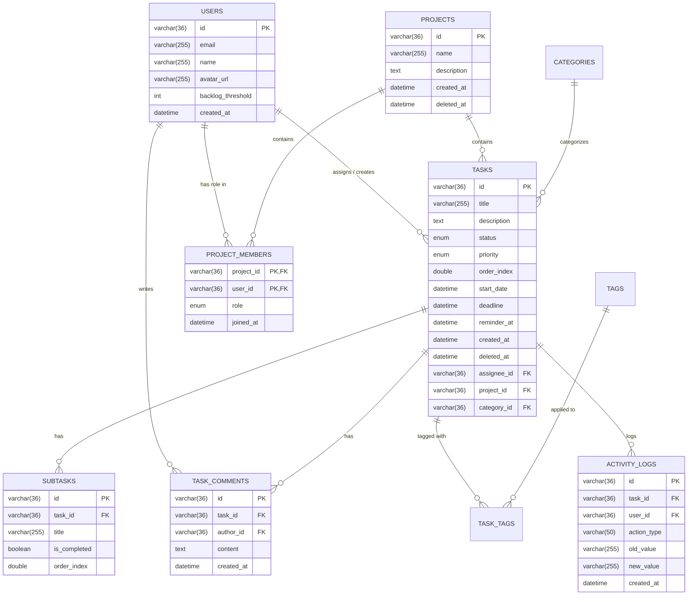

# 🗄️ Thiết kế Cơ sở dữ liệu (MySQL)

Tài liệu này mô tả cấu trúc cơ sở dữ liệu quan hệ (RDBMS) sử dụng cho dự án **Smart Workflow & Adaptive Todo App**, được thiết kế để hỗ trợ tối đa các tính năng làm việc nhóm, phân quyền, và giao diện kéo thả.

## 1. Sơ đồ Quan hệ Thực thể (ERD)



---

## 2. Mã lệnh Khởi tạo (MySQL DDL Script)

Đoạn script dưới đây có thể được chạy trực tiếp trên MySQL Server để tạo schema cho dự án.

```sql
-- 1. Bảng Người dùng (OAuth Users)
CREATE TABLE users (
    id VARCHAR(36) PRIMARY KEY, -- Trùng với UID của Firebase/OAuth
    email VARCHAR(255) NOT NULL UNIQUE,
    name VARCHAR(255) NOT NULL,
    avatar_url VARCHAR(500),
    backlog_threshold INT DEFAULT 10,
    created_at TIMESTAMP DEFAULT CURRENT_TIMESTAMP
);

-- 2. Bảng Dự án (Projects)
CREATE TABLE projects (
    id VARCHAR(36) PRIMARY KEY,
    name VARCHAR(255) NOT NULL,
    description TEXT,
    created_at TIMESTAMP DEFAULT CURRENT_TIMESTAMP,
    deleted_at DATETIME NULL -- Phục vụ Xóa mềm (Thùng rác)
);

-- 3. Bảng Phân quyền Thành viên trong Dự án
CREATE TABLE project_members (
    project_id VARCHAR(36) NOT NULL,
    user_id VARCHAR(36) NOT NULL,
    role ENUM('owner', 'admin', 'member', 'viewer') DEFAULT 'member',
    joined_at TIMESTAMP DEFAULT CURRENT_TIMESTAMP,
    
    PRIMARY KEY (project_id, user_id),
    FOREIGN KEY (project_id) REFERENCES projects(id) ON DELETE CASCADE,
    FOREIGN KEY (user_id) REFERENCES users(id) ON DELETE CASCADE
);

-- 4. Bảng Danh mục (Categories)
CREATE TABLE categories (
    id VARCHAR(36) PRIMARY KEY,
    name VARCHAR(255) NOT NULL,
    color_hex VARCHAR(7) -- Ví dụ: '#FF5733'
);

-- 5. Bảng Công việc (Tasks)
CREATE TABLE tasks (
    id VARCHAR(36) PRIMARY KEY,
    title VARCHAR(255) NOT NULL,
    description TEXT,
    status ENUM('todo', 'in_progress', 'done', 'cancelled') DEFAULT 'todo',
    priority ENUM('low', 'medium', 'high', 'urgent') DEFAULT 'medium',
    order_index DOUBLE DEFAULT 0, -- Phục vụ tính năng kéo thả (Drag & Drop)
    
    -- Timestamps
    start_date DATETIME NULL,
    deadline DATETIME NULL,
    reminder_at DATETIME NULL,
    created_at TIMESTAMP DEFAULT CURRENT_TIMESTAMP,
    deleted_at DATETIME NULL, -- Xóa mềm (Soft delete)
    
    -- Foreign Keys
    assignee_id VARCHAR(36) NULL,
    project_id VARCHAR(36) NULL,
    category_id VARCHAR(36) NULL,
    
    FOREIGN KEY (assignee_id) REFERENCES users(id) ON DELETE SET NULL,
    FOREIGN KEY (project_id) REFERENCES projects(id) ON DELETE SET NULL,
    FOREIGN KEY (category_id) REFERENCES categories(id) ON DELETE SET NULL
);

-- 6. Bảng Công việc phụ (Subtasks / Checklist)
CREATE TABLE subtasks (
    id VARCHAR(36) PRIMARY KEY,
    task_id VARCHAR(36) NOT NULL,
    title VARCHAR(255) NOT NULL,
    is_completed BOOLEAN DEFAULT FALSE,
    order_index DOUBLE DEFAULT 0, -- Sắp xếp Subtask
    created_at TIMESTAMP DEFAULT CURRENT_TIMESTAMP,
    
    FOREIGN KEY (task_id) REFERENCES tasks(id) ON DELETE CASCADE
);

-- 7. Bảng Bình luận (Task Comments)
CREATE TABLE task_comments (
    id VARCHAR(36) PRIMARY KEY,
    task_id VARCHAR(36) NOT NULL,
    author_id VARCHAR(36) NOT NULL,
    content TEXT NOT NULL,
    created_at TIMESTAMP DEFAULT CURRENT_TIMESTAMP,
    
    FOREIGN KEY (task_id) REFERENCES tasks(id) ON DELETE CASCADE,
    FOREIGN KEY (author_id) REFERENCES users(id) ON DELETE CASCADE
);

-- 8. Bảng Lịch sử hoạt động (Activity Logs)
CREATE TABLE activity_logs (
    id VARCHAR(36) PRIMARY KEY,
    task_id VARCHAR(36) NOT NULL,
    user_id VARCHAR(36) NOT NULL,
    action_type VARCHAR(50) NOT NULL, -- VD: 'CREATED_TASK', 'CHANGED_STATUS'
    old_value VARCHAR(255),
    new_value VARCHAR(255),
    created_at TIMESTAMP DEFAULT CURRENT_TIMESTAMP,
    
    FOREIGN KEY (task_id) REFERENCES tasks(id) ON DELETE CASCADE,
    FOREIGN KEY (user_id) REFERENCES users(id) ON DELETE CASCADE
);

-- 9. Bảng Nhãn (Tags)
CREATE TABLE tags (
    id VARCHAR(36) PRIMARY KEY,
    name VARCHAR(50) NOT NULL UNIQUE,
    color_hex VARCHAR(7)
);

-- 10. Bảng trung gian Task-Tag (N-N)
CREATE TABLE task_tags (
    task_id VARCHAR(36) NOT NULL,
    tag_id VARCHAR(36) NOT NULL,
    
    PRIMARY KEY (task_id, tag_id),
    FOREIGN KEY (task_id) REFERENCES tasks(id) ON DELETE CASCADE,
    FOREIGN KEY (tag_id) REFERENCES tags(id) ON DELETE CASCADE
);
```